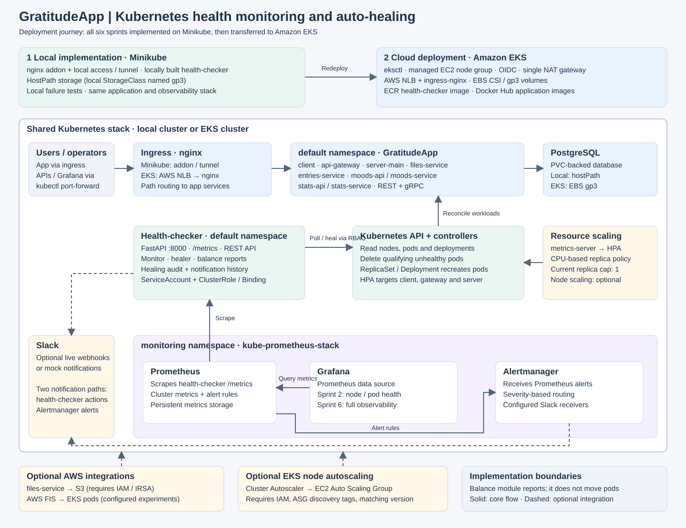

# GratitudeApp — Kubernetes Cluster Health Checker and Auto-Healing

## Architecture



All six sprints were first implemented on **Minikube**, then transferred to
**Amazon EKS**. The application, health-checker, and monitoring stack share the
same Kubernetes design; ingress, persistent storage, image distribution, and
AWS integrations differ between environments. See [Implementation and migration](#implementation-and-migration-minikube-to-eks)
for the sprint runbooks and environment differences.

The diagram shows the implemented Kubernetes stack and its deployment journey.
Solid arrows show application, monitoring, and control flows; dashed arrows show
optional integrations or environment-specific dependencies. The editable diagram
source is [architecture.svg](docs/diagrams/architecture.svg).

GratitudeApp comprises nine application microservices plus PostgreSQL. A Python /
FastAPI health-checker monitors nodes, pods, and deployments, deletes qualifying
unhealthy pods so Kubernetes can recreate them, records healing actions, and
reports pod distribution across nodes. Prometheus collects metrics, Grafana
provides dashboards, and Alertmanager and the health-checker provide separate
notification paths to Slack when configured.

## Problem Statement

Manually monitoring and remediating Kubernetes clusters is
time-consuming and error-prone, especially for small DevOps teams
running multi-service applications. This project automates detection
and recovery of common issues (failed pods, unresponsive nodes,
resource pressure) for GratitudeApp's microservices, reducing downtime
and manual toil while keeping the team informed via alerts and a
dashboard.

## Project Goals

1. **Automated health monitoring** — track node health, pod statuses,
   and resource utilization for GratitudeApp's services.
2. **Self-healing actions** — restart failed pods, reschedule
   workloads, and trigger scaling events when needed.
3. **Real-time alerts and notifications** — inform the team of
   critical issues requiring manual intervention.
4. **Web dashboard** — show real-time health status, historical data,
   and auto-healing logs for transparency and traceability.

## The Hosted Application: GratitudeApp

GratitudeApp is a journaling app with mood tracking, AI-assisted
entries, and stats — built as 9 microservices:

| Service | Role | Port |
|---|---|---|
| `client` | React frontend | 3000 |
| `api-gateway` | Routes requests to backend services | 5000 |
| `server-main` | Core server (auth, etc.) | 5001 |
| `entries-service` | gRPC service for journal entries | 50051 |
| `moods-api` | REST API for moods | 5002 |
| `moods-service` | gRPC service for moods | 50052 |
| `stats-api` | REST API for stats | 5003 |
| `stats-service` | gRPC service for stats | 50053 |
| `files-service` | File upload/download (S3) | 5004 |
| `postgres` | Database | 5432 |

These run as-is using the existing Docker Hub images
(`prashantdey/merndemoapp:*`) referenced in `k8s-health-checker/gratitude-k8s/`.

## Tools & Technologies

| Tool | Purpose |
|---|---|
| Minikube | Local implementation and validation of all six sprints |
| eksctl | Provision EKS cluster, VPC, EBS CSI driver addon, OIDC |
| Amazon EKS | Managed Kubernetes cluster hosting GratitudeApp + health-checker |
| Python (FastAPI) | Health-checker API, monitoring, and self-healing logic |
| Kubernetes Python client | Interact with and manage cluster resources |
| Prometheus | Metrics collection from the cluster and health-checker |
| Grafana | Visualization / dashboard |
| Alertmanager | Routes alerts to Slack |
| AWS FIS (Fault Injection Simulator) | Deliberately injects failures to test self-healing |
| Docker + Amazon ECR | Containerize and store the health-checker image |

## Project Structure

```text
.
├── README.md
├── Project_details.txt                # Original project requirements
├── GratitudeApp-main/                 # Hosted application source
│   ├── client/                         # React frontend
│   └── k8s/                            # Application manifests in source project
├── k8s-health-checker/                 # Health-checker and deployment automation
│   ├── healthchecker-app/              # FastAPI, monitor, healer, balancer, Slack notifier
│   ├── gratitude-k8s/                  # Application manifests used by deployment scripts
│   ├── chaos/                         # AWS FIS templates and RBAC
│   ├── eksctl/cluster.yaml             # Cluster config used by provisioning script
│   ├── deploy/
│   │   ├── healthchecker/              # Deployment, Service, RBAC
│   │   ├── prometheus/                 # kube-prometheus-stack Helm values
│   │   ├── grafana/                    # Sprint 2 and Sprint 6 dashboards
│   │   ├── alerts/                     # PrometheusRules and Alertmanager config
│   │   └── autoscaling/                # HPAs, load generator, optional node autoscaler
│   ├── scripts/                       # Build/push, provision, deploy, teardown
│   └── docs/SECRETS.md
├── k8s-local/                         # Minikube storage and health-checker overrides
├── docs/
│   ├── minikube_implementation/        # Local setup and sprint implementation guides
│   ├── eks_migration/                  # Migration overview and EKS sprint runbooks
│   ├── diagrams/architecture.svg       # Current architecture diagram
│   ├── alerting-and-notifications.md
│   └── user-guide.md
├── cluster.yaml                       # Separate root-level cluster configuration
└── scripts/99-teardown.sh              # Root-level teardown helper
```

Run the numbered deployment scripts from `k8s-health-checker/`. Its
`eksctl/cluster.yaml` is the configuration used by the provisioning script;
the root-level `cluster.yaml` is a separate copy and currently differs.


## Prerequisites

- Minikube for the local implementation (see the [local setup guide](docs/minikube_implementation/Readme_Local.md))
- AWS account + AWS CLI configured (`aws configure`)
- `eksctl`
- `kubectl`
- `helm` 3.x
- Docker (for the health-checker image only — GratitudeApp uses
  existing Docker Hub images)
- Python 3.12 (for local development of the health-checker)

## Cost Notes

This project runs on a small, short-lived EKS cluster:

- EKS control plane: ~$0.10/hour (~$72/month if left running)
- 2x t3.medium worker nodes: ~$0.083/hour combined
- Single NAT gateway (not one per AZ)
- ingress-nginx NLB: small hourly + per-GB cost while running
- Prometheus retention set to 3 days, modest resource requests

**From `k8s-health-checker/`, run `scripts/99-teardown.sh` after your demo/screenshots to avoid
ongoing charges.** A typical end-to-end demo (provision → deploy →
test → screenshot → destroy) costs roughly **$5-15** depending on how
long the cluster stays up and how long the NLB runs.

## Configuration and Implementation Limits

- `files-service` S3/IRSA is **not configured yet**. The pod may run
  but S3 upload/download calls will fail until an IAM role + service
  account are set up (see the original `README.md` in the GratitudeApp
  source for the IRSA steps — this can be added in a later sprint if
  needed).
- `openai-api-secret.yml` contains a placeholder key. AI-assisted
  journal features will not work until a real OpenAI key is set (see
  [secret configuration guide](k8s-health-checker/docs/SECRETS.md)).

---

## Sprint-by-Sprint Progress

### Sprint 1: Project Setup and Kubernetes Cluster Access

**Goal:** Establish a foundation for the project by setting up the
necessary environment, tools, and access to Kubernetes resources, and
get GratitudeApp running on EKS.

**What was done:**

1. **Project structure and repository initialized.**
   The repo is organized into: `healthchecker-app/` (the Python/
   FastAPI health-checker service we're building), `gratitude-k8s/`
   (the existing GratitudeApp Kubernetes manifests, used as-is),
   `chaos/` (AWS FIS templates for fault injection, used in Sprint 3),
   `eksctl/` (EKS cluster config), `deploy/` (manifests and
   Helm values for the health-checker and Prometheus stack), and
   `scripts/` (numbered, ordered automation scripts).

2. **Kubernetes cluster access configured via eksctl on EKS.**
   `eksctl/cluster.yaml` defines a single `ClusterConfig` that
   provisions everything needed in one command:
   - A VPC with a **single NAT gateway** (`vpc.nat.gateway: Single`)
     to minimize cost.
   - One managed node group of **2x t3.medium** nodes (min 1, max 3 —
     headroom for Sprint 4's scaling demo), with a 20GB disk each.
   - **OIDC provider enabled** (`iam.withOIDC: true`), needed for
     IRSA-based access such as the EBS CSI driver now and
     files-service-sa / FIS later.
   - The **aws-ebs-csi-driver addon** with `wellKnownPolicies`
     (required by GratitudeApp's `gp3` StorageClass and Postgres PVC) —
     eksctl automatically creates the IAM role and IRSA binding for
     this addon.
   `scripts/01-provision-eks.sh` runs `eksctl create cluster -f
   eksctl/cluster.yaml` (which also configures kubectl automatically),
   then installs **ingress-nginx** via Helm (matching GratitudeApp's
   `ingressClassName: nginx`), exposed via an AWS Network Load
   Balancer.

3. **GratitudeApp deployed using its existing manifests and images.**
   `gratitude-k8s/` contains the original manifests from the
   GratitudeApp repo, applied in dependency order by
   `scripts/02-deploy-gratitudeapp.sh`: StorageClass → secrets/config →
   Postgres (PVC + Deployment + Service) → backend microservices
   (api-gateway, entries, moods-api/service, stats-api/service,
   files-service, server-main) → frontend client → ingress → one-time
   DB migration job. All services use the existing
   `prashantdey/merndemoapp:*` images from Docker Hub — no rebuilding
   needed for Sprint 1.

4. **Basic API access to Kubernetes resources, via the health-checker.**
   `deploy/healthchecker/rbac.yaml` defines a `health-checker`
   ServiceAccount (in the `default` namespace, alongside GratitudeApp)
   with a ClusterRole granting read access to nodes/pods/services/
   events, and update access to deployments/replicasets/HPAs for
   self-healing in later sprints.

   `healthchecker-app/` is a small **FastAPI** service:
   - `k8s_client.py` wraps the official Kubernetes Python client,
     using in-cluster config (via the `health-checker` ServiceAccount)
     or falling back to local kubeconfig for development.
   - `monitor.py` polls nodes, pods, and deployments in the `default`
     namespace every 15 seconds and updates Prometheus gauges
     (`healthchecker_node_ready`, `healthchecker_pod_restarts_total`,
     `healthchecker_pod_phase_running`,
     `healthchecker_deployment_available_replicas`, etc.).
   - `main.py` exposes `/healthz`, `/metrics` (Prometheus format),
     `/api/nodes`, `/api/pods`, `/api/deployments`, and `/api/summary`
     — proving the app can authenticate to and query the Kubernetes
     API for GratitudeApp's resources.
   - `Dockerfile` packages the app as a small Python container image.

5. **Prometheus installed and configured for Kubernetes.**
   `deploy/prometheus/prometheus-values.yaml` configures the
   `kube-prometheus-stack` Helm chart (Prometheus + Grafana +
   Alertmanager) with conservative resource requests, 3-day retention,
   `gp3` storage for Prometheus data, and an `additionalScrapeConfigs`
   entry that scrapes the health-checker's `/metrics` endpoint via its
   pod annotations. This lays the groundwork for Sprint 2 (dashboards),
   Sprint 5 (Alertmanager → Slack), and Sprint 6 (Grafana dashboard).

**How to run Sprint 1 end-to-end:**

```bash
# 1. Provision the EKS cluster (eksctl: VPC + EKS + node group + EBS CSI + ingress-nginx)
./scripts/01-provision-eks.sh

# 2. Review/update secrets (see docs/SECRETS.md)
#    - gratitude-k8s/database-secret.yml
#    - gratitude-k8s/openai-api-secret.yml

# 3. Deploy GratitudeApp using its existing Docker Hub images
./scripts/02-deploy-gratitudeapp.sh

# 4. Build the health-checker image and push it to ECR
./scripts/00-build-and-push-healthchecker.sh
# -> copy the printed image URI into deploy/healthchecker/deployment.yaml's
#    `image:` field, replacing <YOUR_ECR_OR_DOCKERHUB_IMAGE>

# 5. Deploy the health-checker + Prometheus/Grafana/Alertmanager stack
./scripts/03-deploy-monitoring.sh

# 6. Verify everything
kubectl get pods
kubectl get ingress

# Health-checker API:
kubectl port-forward -n default svc/health-checker-cluster-ip-service 8000:8000 &
curl http://localhost:8000/api/summary

# GratitudeApp (via ingress NLB) — get the external hostname:
kubectl get svc -n ingress-nginx ingress-nginx-controller

# Grafana:
kubectl port-forward -n monitoring svc/monitoring-grafana 3000:80 &
# open http://localhost:3000 (admin / changeme)

# 7. When done with screenshots/demo, tear everything down
./scripts/99-teardown.sh
```

**Deliverable:** eksctl-provisioned EKS cluster on AWS (with EBS CSI
driver, OIDC, and ingress-nginx), GratitudeApp's 9 microservices +
Postgres running and reachable via ingress, RBAC configured for the
health-checker ServiceAccount, a FastAPI health-checker deployed to the
cluster that successfully lists GratitudeApp's nodes/pods/deployments
via the Kubernetes API, and a running Prometheus/Grafana/Alertmanager
stack in the `monitoring` namespace.

---

### Sprint 2: Health Monitoring Module (Node & Pod Checks)

**Goal:** Enable basic health checks on nodes and pods and set up
alerts for critical issues.

**Work scope:**
- Extend `monitor.py`'s checks: add per-pod readiness/condition
  detail, and per-deployment "all replicas available" status for each
  GratitudeApp service (client, api-gateway, entries, moods, stats,
  files-service, server-main, postgres).
- Add Grafana dashboards (provisioned via the Helm values'
  `dashboardsConfigMaps` or a `ConfigMap` with `grafana_dashboard:
  "1"` label) visualizing node/pod health and GratitudeApp service
  availability.
- Define initial Alertmanager rules for thresholds (e.g. node
  NotReady > 2 minutes, any GratitudeApp deployment with
  available < desired replicas for > 1 minute, pod restart count >
  N).

---

### Sprint 3: Self-Healing Mechanisms (Pod Recovery)

**Goal:** Automate pod recovery processes and ensure that self-healing
actions are logged for transparency.

**Work scope:**
- Add a self-healing module to `healthchecker-app/` that detects and
  restarts/deletes unresponsive or failed GratitudeApp pods (using
  `delete` on pods owned by a Deployment, letting the ReplicaSet
  recreate them).
- Add automated cleanup for pods stuck in `CrashLoopBackOff` or
  `Evicted` states.
- **Use the existing `chaos/` AWS FIS templates** to deliberately
  inject failures (e.g. `fis-template.json` applies CPU stress to
  `server-deployment` pods) and validate that the health-checker
  detects and recovers from them — applying `chaos/rbac.yml` and the
  FIS service-account/role manifests sets up the permissions FIS needs.
- Implement structured audit logging of every healing action taken
  (what, when, why, result), exposed via a new `/api/healing-log`
  endpoint.

---

### Sprint 4: Advanced Self-Healing (Node Scaling & Resource Balancing)

**Goal:** Ensure the system can scale and balance resources
automatically, optimizing cluster performance and cost.

**Work scope:**
- Integrate the Kubernetes Cluster Autoscaler (or Karpenter) on EKS so
  the node group (min 1 / max 3, already configured in
  `eksctl/cluster.yaml`) can scale up/down based on demand.
- Configure Horizontal Pod Autoscalers for GratitudeApp's
  higher-traffic services (e.g. `api-gateway`, `client`).
- Add resource-balancing logic to redistribute pods across nodes.
- Load-test these behaviors with a temporary load-generator
  deployment hitting the ingress endpoint, and screenshot the
  resulting scale-out/scale-in events.

---

### Sprint 5: Alerting and Notification System Integration

**Goal:** Implement a comprehensive alerting and notification system to
keep the team informed of critical events and actions.

**Work scope:**
- Add a Slack notifier module to `healthchecker-app/` using the Slack
  API (incoming webhook) for real-time notifications.
- Configure Alertmanager routing/receivers for multiple severity
  levels (info/warning/critical), pointing at the Slack webhook.
- End-to-end test alert delivery for both monitoring alerts (e.g. a
  GratitudeApp deployment going unavailable) and self-healing action
  notifications (e.g. "restarted pod X due to CrashLoopBackOff").
- Document alert setup and customization in `docs/`.

---

### Sprint 6: Web Dashboard and Project Documentation

**Goal:** Deliver a user-friendly dashboard for monitoring cluster
health and document the project for deployment in real-world
environments.

**Work scope:**
- Build out Grafana dashboards showing live health status of
  GratitudeApp's services, historical trends, and auto-healing/FIS
  experiment logs.
- Wire Prometheus metrics and alert/action history into the dashboard.
- Write full user documentation: setup, configuration, usage, and
  troubleshooting guides (building on `docs/SECRETS.md`).
- Final end-to-end testing on EKS, screenshot capture (including a
  full GratitudeApp demo via the ingress URL, Grafana dashboards, and
  a chaos-experiment-triggered self-healing event), and teardown via
  `scripts/99-teardown.sh`.

---

## Implementation and Migration: Minikube to EKS

The sprint section above describes the original scope of work. **All six sprints were implemented first
on Minikube and then transferred to EKS**; the implementation and migration
references below describe that sequence separately from the plan.

### Phase 1: Implement all sprints on Minikube

The [local deployment guide](docs/minikube_implementation/Readme_Local.md)
sets up GratitudeApp, the health-checker, and `kube-prometheus-stack`. Local
overrides in `k8s-local/` use Minikube hostPath storage and a locally built
health-checker image. Subsequent sprints add readiness metrics, healing,
resource distribution reports, notifications, and Grafana dashboards.

### Phase 2: Transfer the stack to Amazon EKS

[EKS transfer snapshot (Word document)](docs/eks_migration/EKS_Capstone.docx)

The [Minikube-to-EKS migration guide](docs/eks_migration/minikube-to-eks-migration.md)
describes the environment changes. The EKS runbooks below carry each sprint's
features onto the managed cluster, using the existing Docker Hub application
images and an ECR-hosted health-checker image. This is a redeployment of the
stack; the guides do not document copying local PostgreSQL volume data to EBS.

| Sprint | Implemented capability | Minikube implementation | EKS transfer and verification |
|---|---|---|---|
| 1 | Application, PostgreSQL, Kubernetes API access, RBAC, monitoring foundation | [Local setup](docs/minikube_implementation/Readme_Local.md) | [EKS Sprint 1](docs/eks_migration/readme_eks_sprint1.md) |
| 2 | Pod readiness, deployment availability, health dashboard, alert rules | [Local Sprint 2](docs/minikube_implementation/Readme_Local_Sprint2.md) | [EKS Sprint 2](docs/eks_migration/readme_eks_sprint2.md) |
| 3 | Pod recovery, cooldown, healing audit log and metrics; failure testing | [Local Sprint 3](docs/minikube_implementation/Readme_Local_Sprint3.md) | [EKS Sprint 3](docs/eks_migration/readme_eks_sprint3.md) |
| 4 | CPU-based HPAs, load testing, pod distribution and capacity reports | [Local Sprint 4](docs/minikube_implementation/Readme_Local_Sprint4.md) | [EKS Sprint 4](docs/eks_migration/readme_eks_sprint4.md) |
| 5 | Health-checker notifications and severity-based Alertmanager routing | [Local Sprint 5](docs/minikube_implementation/Readme_Local_Sprint5.md) | [EKS Sprint 5](docs/eks_migration/readme_eks_sprint5.md) |
| 6 | Full observability dashboard, documentation and end-to-end checks | [Local Sprint 6](docs/minikube_implementation/Readme_Local_Sprint6.md) | [EKS Sprint 6](docs/eks_migration/readme_eks_sprint6.md) |

### What changed between environments

| Component | Minikube | Amazon EKS |
|---|---|---|
| Cluster | Local Minikube cluster | eksctl-managed EKS cluster and EC2 managed node group |
| Application entry | nginx ingress addon; local access / tunnel | AWS NLB → ingress-nginx → ClusterIP services |
| Persistent storage | `k8s-local/storageclass-local.yaml`: class named `gp3`, backed by `k8s.io/minikube-hostpath` | EBS CSI-backed `gp3` storage for PostgreSQL and Prometheus |
| Health-checker image | Local Docker build and local deployment override | Build/push to ECR; EKS deployment pulls the image |
| Application images | Existing `prashantdey/merndemoapp:*` images | Same Docker Hub images |
| Observability | Prometheus, Grafana, Alertmanager in `monitoring` | Same stack, dashboard ConfigMaps and PrometheusRules reapplied |
| Internal service access | Port-forward health-checker, Grafana and Prometheus | Same port-forward approach; application ingress is public via NLB |
| Failure testing | Local failure scenarios and recovery checks | Recovery checks plus optional AWS FIS experiment |
| Node scaling | Local capacity; HPA depends on metrics-server | Optional Cluster Autoscaler after IAM, ASG tags and compatible image are configured |

The implemented behavior has these configuration boundaries:

- `healer.py` handles pod recovery; Kubernetes controllers recreate deleted
  workload pods. Node readiness is monitored, rather than repaired directly.
- `balancer.py` reports distribution and capacity metrics; it does not actively
  move pods. The checked-in HPAs currently have both minimum and maximum replicas
  set to **1**, so scale-out demonstrations require increasing the maximum.
- AWS FIS is an optional EKS-only exercise. Cluster Autoscaler is also optional
  and its checked-in manifest needs configuration before use.
- Slack supports mock and live delivery. The current EKS health-checker manifest
  references the `health-checker-slack` Secret; supply it with an empty webhook
  for mock mode or a real webhook for live delivery. Alertmanager requires its
  own receiver configuration. See [alerting and notifications](docs/alerting-and-notifications.md).
- S3 file operations depend on files-service IAM/IRSA configuration; AI-assisted
  entries require a valid OpenAI key. See [secrets](k8s-health-checker/docs/SECRETS.md).

For setup, operation and troubleshooting, start with the [user guide](docs/user-guide.md)
and follow the environment-specific sprint runbooks in order. Some older guides
use paths relative to `k8s-health-checker/`; the project tree above shows their
current locations from the repository root.

---

## Deliverables Summary

- GratitudeApp running on EKS via existing Docker Hub images
- Automated Health Monitoring Tool for GratitudeApp's Kubernetes
  resources
- Self-Healing Mechanisms for both pod and node recovery, validated
  via AWS FIS chaos experiments
- Real-Time Alerting and Notifications through Slack
- Web Dashboard (Grafana) for real-time and historical monitoring
- Comprehensive Documentation for setup, usage, and troubleshooting
- eksctl-based cluster config for reproducible, cost-controlled EKS
  provisioning and teardown

## Evaluation Criteria

| Category | Weight |
|---|---|
| Documentation | 15% |
| Implementation | 75% |
| Cost Optimization | 10% |
