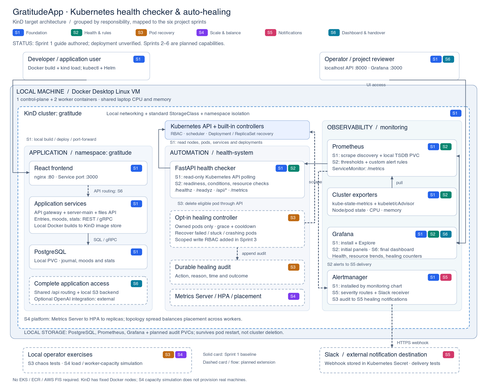

# Sprint 1 — Build the local Kubernetes foundation with KinD

This is a hands-on implementation guide, not an installed implementation. Run the commands yourself, in order, from the repository root. Each `cat > ...` block creates the file named in that block. Existing EKS files remain untouched.

The Sprint 1 requirements in `Project_details.txt` are:

1. Define the project structure.
2. Set up Kubernetes cluster access.
3. Build basic API access for nodes, pods, and services.
4. Install Prometheus to monitor Kubernetes.

This guide also covers containerizing the health checker, deploying it with read-only RBAC, integrating its metrics with Prometheus, opening Grafana, and deploying the repository's GratitudeApp as the monitored workload. Healing, custom health rules, scaling, Slack, and the final dashboard belong to later sprints.

**End state:** a three-node Kubernetes cluster inside Docker, GratitudeApp in `gratitude`, the health checker in `health-system`, and Prometheus/Grafana/Alertmanager in `monitoring`. No AWS account, EKS, ECR, NLB, or cloud storage is required for the core lab.

## 1. Understand the local architecture

See the [sprint-mapped KinD architecture](ARCHITECTURE.md) for the full six-sprint target design.



```text
Your Mac
  Docker Desktop Linux VM
    Kind cluster: gratitude
      gratitude-control-plane    Kubernetes API and controllers
      gratitude-worker           Schedulable application/monitoring pods
      gratitude-worker2          Schedulable application/monitoring pods

    gratitude namespace          GratitudeApp + PostgreSQL
    health-system namespace      Python/FastAPI health checker
    monitoring namespace         Prometheus Operator, Prometheus,
                                 Grafana, Alertmanager, exporters

Browser/curl -> localhost port-forward -> Kubernetes Service -> Pod
Health checker -> Kubernetes API -> nodes/pods/services/deployments
Prometheus -> ServiceMonitor -> health checker /metrics
Prometheus -> kube-state-metrics / kubelet -> cluster metrics
```

KinD workers share your laptop's resources. Three Kubernetes nodes do not provide three physical machines' worth of CPU or memory. Later node-scaling exercises must explicitly distinguish simulated capacity changes from creating real worker machines.

Use the existing application source, but create the infrastructure and health checker in a new `kind-lab/` directory. Do not run `k8s-health-checker/scripts/01-provision-eks.sh`, its ECR build script, or its EKS teardown script for this lab.

## 2. Install and verify tools

### 2.1 macOS prerequisites

Install Docker Desktop from [Docker's Mac installation guide](https://docs.docker.com/desktop/setup/install/mac-install/), launch it, and wait until its engine is running. Allocate roughly **6 CPUs, 10–12 GiB memory, and 25 GiB available disk** as a practical starting point for the full application plus monitoring. These are lab estimates, not enforced requirements.

If Homebrew is already installed:

```bash
brew install kind kubectl helm python@3.12
```

For Linux, install Docker Engine and use the platform instructions in the [KinD quick start](https://kind.sigs.k8s.io/docs/user/quick-start/) and [kubectl installation guide](https://kubernetes.io/docs/tasks/tools/). The remaining shell commands use bash/zsh-compatible syntax.

Verify:

```bash
docker version
docker info
kind version
kubectl version --client
helm version
python3.12 --version
```

**Pass condition:** Docker reports a Server section; all tools return versions. `Cannot connect to the Docker daemon` means the engine is unavailable: fix that before continuing. Docker commands in this guide run against your local Docker engine.

### 2.2 Confirm branch and location

```bash
cd /path/to/Capstone_Project_HeroVired
git branch --show-current
git status --short
```

Expected branch: `KinD`. If necessary, switch only after reviewing your local changes:

```bash
git switch KinD
```

Do not copy the example `cd` path literally; use your own checkout location.

## 3. Create the lab structure

```bash
mkdir -p kind-lab/{cluster,app,healthchecker,k8s,monitoring,evidence}
cat > kind-lab/.gitignore <<'EOF'
.venv/
__pycache__/
*.pyc
*.secret.yaml
*.tgz
charts/
evidence/
EOF
```

Resulting structure by the end of this sprint:

```text
kind-lab/
├── cluster/kind.yaml
├── app/                         Generated local GratitudeApp manifests
├── healthchecker/
│   ├── main.py
│   ├── requirements.txt
│   ├── Dockerfile
│   └── .dockerignore
├── k8s/
│   ├── namespaces.yaml
│   ├── rbac.yaml
│   └── healthchecker.yaml
├── monitoring/
│   ├── values.yaml
│   ├── chart-version.txt
│   └── servicemonitor.yaml
└── evidence/                    Local validation output, ignored by Git
```

The new application is independent of `k8s-health-checker/healthchecker-app/`. That older implementation is a reference; do not combine the two deployment paths.

## 4. Create the KinD cluster

### 4.1 Write the cluster configuration

```bash
cat > kind-lab/cluster/kind.yaml <<'EOF'
kind: Cluster
apiVersion: kind.x-k8s.io/v1alpha4
name: gratitude
nodes:
  - role: control-plane
  - role: worker
  - role: worker
EOF
```

No host port mappings are necessary because this sprint uses port-forwarding. This avoids installing ingress before the basic cluster is working.

### 4.2 Create and verify

```bash
kind create cluster --config kind-lab/cluster/kind.yaml --wait 180s
kubectl config use-context kind-gratitude
kubectl --context kind-gratitude cluster-info
kubectl --context kind-gratitude wait --for=condition=Ready nodes --all --timeout=180s
kubectl --context kind-gratitude get nodes -o wide
kubectl --context kind-gratitude get pods -A
```

Expected: one control-plane and two workers, all `Ready`; CoreDNS and the networking components run successfully.

A second `kind create cluster` with the same name will fail because the cluster exists. Reuse it instead of deleting it automatically.

### 4.3 Record versions for reproducibility

```bash
kind version > kind-lab/evidence/kind-version.txt
kubectl --context kind-gratitude version -o yaml > kind-lab/evidence/kubernetes-version.yaml
docker inspect gratitude-control-plane --format '{{.Config.Image}}' \
  > kind-lab/cluster/node-image.txt
```

KinD uses the node image bundled as the default for your installed KinD release. For subsequent recreations, use the recorded image with `kind create cluster --image IMAGE ...`. Record its digest too if you need identical image bytes. Do not mix arbitrary KinD and Kubernetes image versions without checking release compatibility.

## 5. Create namespaces

```bash
cat > kind-lab/k8s/namespaces.yaml <<'EOF'
apiVersion: v1
kind: Namespace
metadata:
  name: gratitude
---
apiVersion: v1
kind: Namespace
metadata:
  name: health-system
---
apiVersion: v1
kind: Namespace
metadata:
  name: monitoring
EOF
kubectl --context kind-gratitude apply -f kind-lab/k8s/namespaces.yaml
```

Namespaces separate the application, the observer, and the monitoring infrastructure. This also allows the observer to have narrowly scoped permissions.

## 6. Implement the read-only health checker from scratch

### 6.1 Dependencies

```bash
cat > kind-lab/healthchecker/requirements.txt <<'EOF'
fastapi==0.115.6
uvicorn==0.34.0
kubernetes==32.0.0
prometheus-client==0.21.1
EOF
```

These are explicit baseline pins, not a claim that they are the latest releases. Before adopting this outside the lab, review dependency updates and the [Python client's Kubernetes compatibility matrix](https://github.com/kubernetes-client/python#compatibility).

### 6.2 API, polling loop, and metrics

Create the entire file below:

```bash
cat > kind-lab/healthchecker/main.py <<'EOF'
import asyncio
import logging
import os
import threading
import time
from contextlib import asynccontextmanager

from fastapi import FastAPI, HTTPException
from fastapi.responses import Response
from kubernetes import client, config
from prometheus_client import CONTENT_TYPE_LATEST, Gauge, generate_latest

logging.basicConfig(level=logging.INFO)
logger = logging.getLogger("healthchecker")
NAMESPACE = os.getenv("TARGET_NAMESPACE", "gratitude")
INTERVAL = int(os.getenv("POLL_INTERVAL_SECONDS", "15"))
if INTERVAL < 1:
    raise ValueError("POLL_INTERVAL_SECONDS must be positive")

NODE_READY = Gauge("healthchecker_node_ready", "Node Ready condition", ["node"])
POD_READY = Gauge("healthchecker_pod_ready", "Pod Ready condition", ["namespace", "pod"])
POD_RESTARTS = Gauge("healthchecker_pod_restarts", "Current container restart count", ["namespace", "pod"])
DEPLOYMENT_AVAILABLE = Gauge("healthchecker_deployment_available_replicas", "Available replicas", ["namespace", "deployment"])
COLLECTION_OK = Gauge("healthchecker_collection_success", "Last API collection succeeded")
LAST_SUCCESS = Gauge("healthchecker_last_success_timestamp_seconds", "Last successful API collection")

state = {"nodes": [], "pods": [], "services": [], "deployments": []}
last_success = 0.0
state_lock = threading.Lock()
stop = threading.Event()


def ready(conditions):
    return any(c.type == "Ready" and c.status == "True" for c in (conditions or []))


def collect(core, apps):
    # Timeouts bound failed calls so readiness can detect stale observations.
    timeout = (3, 10)
    nodes = core.list_node(_request_timeout=timeout).items
    pods = core.list_namespaced_pod(NAMESPACE, _request_timeout=timeout).items
    services = core.list_namespaced_service(NAMESPACE, _request_timeout=timeout).items
    deployments = apps.list_namespaced_deployment(NAMESPACE, _request_timeout=timeout).items
    snapshot = {
        "nodes": [{"name": n.metadata.name, "ready": ready(n.status.conditions)} for n in nodes],
        "pods": [{
            "name": p.metadata.name,
            "namespace": p.metadata.namespace,
            "phase": p.status.phase,
            "ready": ready(p.status.conditions),
            "node": p.spec.node_name,
            "restarts": sum(c.restart_count or 0 for c in (p.status.container_statuses or [])),
        } for p in pods],
        "services": [{
            "name": s.metadata.name,
            "cluster_ip": s.spec.cluster_ip,
            "ports": [p.port for p in (s.spec.ports or [])],
        } for s in services],
        "deployments": [{
            "name": d.metadata.name,
            "desired": d.spec.replicas or 0,
            "available": d.status.available_replicas or 0,
        } for d in deployments],
    }
    # Clear old labels, otherwise deleted pods remain visible in these gauges.
    # Prometheus retains historical samples in its own time-series database.
    for metric in (NODE_READY, POD_READY, POD_RESTARTS, DEPLOYMENT_AVAILABLE):
        metric.clear()
    for n in snapshot["nodes"]:
        NODE_READY.labels(n["name"]).set(int(n["ready"]))
    for p in snapshot["pods"]:
        POD_READY.labels(NAMESPACE, p["name"]).set(int(p["ready"]))
        POD_RESTARTS.labels(NAMESPACE, p["name"]).set(p["restarts"])
    for d in snapshot["deployments"]:
        DEPLOYMENT_AVAILABLE.labels(NAMESPACE, d["name"]).set(d["available"])
    return snapshot


def poll(core, apps):
    global state, last_success
    while not stop.is_set():
        try:
            snapshot = collect(core, apps)
            timestamp = time.time()
            with state_lock:
                state = snapshot
                last_success = timestamp
            COLLECTION_OK.set(1)
            LAST_SUCCESS.set(timestamp)
            logger.info("Collected %s pods from %s", len(snapshot["pods"]), NAMESPACE)
        except Exception:
            COLLECTION_OK.set(0)
            logger.exception("Kubernetes collection failed")
        stop.wait(INTERVAL)


@asynccontextmanager
async def lifespan(app):
    try:
        config.load_incluster_config()
    except config.ConfigException:
        config.load_kube_config(context=os.getenv("KUBE_CONTEXT", "kind-gratitude"))
    core, apps = client.CoreV1Api(), client.AppsV1Api()
    stop.clear()
    worker = threading.Thread(target=poll, args=(core, apps), daemon=True)
    worker.start()
    yield
    stop.set()
    await asyncio.to_thread(worker.join, 15)


app = FastAPI(title="KinD Health Checker — Sprint 1", lifespan=lifespan)


@app.get("/healthz")
def healthz():
    return {"status": "ok"}


@app.get("/readyz")
def readyz():
    with state_lock:
        fresh = last_success > 0 and time.time() - last_success < INTERVAL * 3
    if not fresh:
        raise HTTPException(status_code=503, detail="Kubernetes observation is stale")
    return {"status": "ready"}


@app.get("/metrics")
def metrics():
    return Response(generate_latest(), headers={"Content-Type": CONTENT_TYPE_LATEST})


@app.get("/api/summary")
def summary():
    with state_lock:
        return {"namespace": NAMESPACE, "last_success": last_success, **state}


@app.get("/api/nodes")
def nodes():
    with state_lock:
        return {"nodes": state["nodes"]}


@app.get("/api/pods")
def pods():
    with state_lock:
        return {"pods": state["pods"]}


@app.get("/api/services")
def services():
    with state_lock:
        return {"services": state["services"]}


@app.get("/api/deployments")
def deployments():
    with state_lock:
        return {"deployments": state["deployments"]}
EOF
```

The Kubernetes client authenticates with kubeconfig when run on your laptop, or with the Pod's ServiceAccount inside the cluster. A single background thread polls every 15 seconds. HTTP routes read its cached snapshot and never modify Kubernetes. `/healthz` checks the web process; `/readyz` checks freshness of API access. Restart counts are gauges because a replaced pod's count can reset.

This is foundational observation, not the complete Sprint 2 health policy. CPU/memory are collected by the monitoring stack; Metrics Server and HPA are addressed in Sprint 4.

### 6.3 Optional local smoke test

```bash
python3.12 -m venv kind-lab/.venv
kind-lab/.venv/bin/python -m pip install -r kind-lab/healthchecker/requirements.txt
TARGET_NAMESPACE=gratitude KUBE_CONTEXT=kind-gratitude \
  kind-lab/.venv/bin/python -m uvicorn main:app \
  --app-dir kind-lab/healthchecker --host 127.0.0.1 --port 8000
```

Leave that terminal running. In another terminal:

```bash
curl -fsS http://127.0.0.1:8000/healthz
curl -fsS http://127.0.0.1:8000/readyz
curl -fsS http://127.0.0.1:8000/api/summary | python3 -m json.tool
```

Initially the namespace has no application pods. An empty pod list is expected. Local kubeconfig generally has administrator rights; the in-cluster deployment below deliberately has fewer permissions. Stop local uvicorn with Ctrl+C before using port 8000 for port-forwarding.

## 7. Build and load the Docker image

```bash
cat > kind-lab/healthchecker/Dockerfile <<'EOF'
FROM python:3.12-slim
WORKDIR /app
COPY requirements.txt .
RUN pip install --no-cache-dir -r requirements.txt \
    && useradd --uid 10001 --create-home appuser
COPY --chown=10001:10001 main.py .
USER 10001:10001
EXPOSE 8000
CMD ["uvicorn", "main:app", "--host", "0.0.0.0", "--port", "8000", "--workers", "1"]
EOF
cat > kind-lab/healthchecker/.dockerignore <<'EOF'
__pycache__
*.pyc
.venv
.git
EOF
docker build -t gratitude/healthchecker:sprint1 kind-lab/healthchecker
kind load docker-image gratitude/healthchecker:sprint1 --name gratitude
```

The image must be loaded into KinD; the host Docker image store is separate from the node container runtime's image store. Build natively on Apple Silicon to avoid unnecessary cross-architecture emulation. Use one uvicorn worker so this simple in-process metric registry and poller have one owner.

## 8. Configure least-privilege Kubernetes API access

Create a ServiceAccount in `health-system`, a node-read ClusterRole, and a namespace-local Role for GratitudeApp observation:

```bash
cat > kind-lab/k8s/rbac.yaml <<'EOF'
apiVersion: v1
kind: ServiceAccount
metadata:
  name: healthchecker
  namespace: health-system
---
apiVersion: rbac.authorization.k8s.io/v1
kind: ClusterRole
metadata:
  name: gratitude-node-reader
rules:
  - apiGroups: [""]
    resources: ["nodes"]
    verbs: ["get", "list", "watch"]
---
apiVersion: rbac.authorization.k8s.io/v1
kind: ClusterRoleBinding
metadata:
  name: gratitude-node-reader
subjects:
  - kind: ServiceAccount
    name: healthchecker
    namespace: health-system
roleRef:
  apiGroup: rbac.authorization.k8s.io
  kind: ClusterRole
  name: gratitude-node-reader
---
apiVersion: rbac.authorization.k8s.io/v1
kind: Role
metadata:
  name: healthchecker-reader
  namespace: gratitude
rules:
  - apiGroups: [""]
    resources: ["pods", "services"]
    verbs: ["get", "list", "watch"]
  - apiGroups: ["apps"]
    resources: ["deployments"]
    verbs: ["get", "list", "watch"]
---
apiVersion: rbac.authorization.k8s.io/v1
kind: RoleBinding
metadata:
  name: healthchecker-reader
  namespace: gratitude
subjects:
  - kind: ServiceAccount
    name: healthchecker
    namespace: health-system
roleRef:
  apiGroup: rbac.authorization.k8s.io
  kind: Role
  name: healthchecker-reader
EOF
kubectl --context kind-gratitude apply -f kind-lab/k8s/rbac.yaml
```

Verify authorization, including negative checks:

```bash
kubectl --context kind-gratitude auth can-i list nodes \
  --as=system:serviceaccount:health-system:healthchecker
kubectl --context kind-gratitude auth can-i list pods -n gratitude \
  --as=system:serviceaccount:health-system:healthchecker
kubectl --context kind-gratitude auth can-i delete pods -n gratitude \
  --as=system:serviceaccount:health-system:healthchecker
kubectl --context kind-gratitude auth can-i get secrets -n gratitude \
  --as=system:serviceaccount:health-system:healthchecker
kubectl --context kind-gratitude auth can-i list pods -n kube-system \
  --as=system:serviceaccount:health-system:healthchecker
```

Expected: `yes`, `yes`, `no`, `no`, `no`. Negative checks return a nonzero exit status; run them individually if your shell has `set -e`. Do not resolve a `403` by binding `cluster-admin`. Inspect the missing resource, verb, and namespace instead.

## 9. Deploy the health checker

```bash
cat > kind-lab/k8s/healthchecker.yaml <<'EOF'
apiVersion: apps/v1
kind: Deployment
metadata:
  name: healthchecker
  namespace: health-system
spec:
  replicas: 1
  selector:
    matchLabels:
      app: healthchecker
  template:
    metadata:
      labels:
        app: healthchecker
    spec:
      serviceAccountName: healthchecker
      securityContext:
        runAsNonRoot: true
        runAsUser: 10001
        runAsGroup: 10001
        seccompProfile:
          type: RuntimeDefault
      containers:
        - name: healthchecker
          image: gratitude/healthchecker:sprint1
          imagePullPolicy: IfNotPresent
          ports:
            - name: http
              containerPort: 8000
          env:
            - name: TARGET_NAMESPACE
              value: gratitude
            - name: POLL_INTERVAL_SECONDS
              value: "15"
          resources:
            requests:
              cpu: 50m
              memory: 128Mi
            limits:
              cpu: 250m
              memory: 256Mi
          securityContext:
            allowPrivilegeEscalation: false
            readOnlyRootFilesystem: true
            capabilities:
              drop: ["ALL"]
          startupProbe:
            httpGet:
              path: /healthz
              port: http
            periodSeconds: 5
            failureThreshold: 24
          readinessProbe:
            httpGet:
              path: /readyz
              port: http
            periodSeconds: 10
          livenessProbe:
            httpGet:
              path: /healthz
              port: http
            periodSeconds: 20
---
apiVersion: v1
kind: Service
metadata:
  name: healthchecker
  namespace: health-system
  labels:
    app: healthchecker
spec:
  selector:
    app: healthchecker
  ports:
    - name: http
      port: 8000
      targetPort: http
EOF
kubectl --context kind-gratitude apply -f kind-lab/k8s/healthchecker.yaml
kubectl --context kind-gratitude rollout status deployment/healthchecker \
  -n health-system --timeout=180s
kubectl --context kind-gratitude logs -n health-system deployment/healthchecker --tail=30
```

In a dedicated terminal:

```bash
kubectl --context kind-gratitude port-forward -n health-system \
  service/healthchecker 8000:8000 --address 127.0.0.1
```

In your command terminal:

```bash
curl -fsS http://127.0.0.1:8000/readyz
curl -fsS http://127.0.0.1:8000/api/nodes | python3 -m json.tool
curl -fsS http://127.0.0.1:8000/api/pods | python3 -m json.tool
curl -fsS http://127.0.0.1:8000/api/services | python3 -m json.tool
curl -fsS http://127.0.0.1:8000/metrics
```

Open `http://127.0.0.1:8000/docs` for Swagger UI. These routes require no application authentication and are exposed only through a localhost port-forward in this lab.

## 10. Deploy GratitudeApp locally

The original repository's Sprint 1 README includes the application deployment. This section adapts its existing manifests rather than applying AWS resources to KinD.

### 10.1 Build native images from the checked-in source

Run from the repository root:

```bash
for service in api-gateway entries-service moods-api moods-service stats-api stats-service files-service; do
  docker build -f "GratitudeApp-main/services/$service/Dockerfile" \
    -t "gratitude/$service:sprint1" GratitudeApp-main || break
done
```

Check that every build succeeded before proceeding; if one fails, fix it and rerun that build. The services above require the application root as context because their Dockerfiles copy `protos/`.

The server and client use their own directory as context. Use local Dockerfiles with a common Node baseline:

```bash
cat > kind-lab/app/server.Dockerfile <<'EOF'
FROM node:22-alpine
WORKDIR /app
COPY package*.json ./
RUN npm ci --omit=dev
COPY . .
EXPOSE 5001
CMD ["node", "index.js"]
EOF
cat > kind-lab/app/client.Dockerfile <<'EOF'
FROM node:22-alpine AS build
WORKDIR /app
COPY package*.json ./
RUN npm ci
COPY . .
RUN npm run build
FROM nginx:stable-alpine
COPY --from=build /app/build /usr/share/nginx/html
COPY nginx.conf /etc/nginx/nginx.conf
EXPOSE 80
CMD ["nginx", "-g", "daemon off;"]
EOF
docker build -f kind-lab/app/server.Dockerfile \
  -t gratitude/server:sprint1 GratitudeApp-main/services/server-main
docker build -f kind-lab/app/client.Dockerfile \
  -t gratitude/client:sprint1 GratitudeApp-main/client
for service in api-gateway entries-service moods-api moods-service stats-api stats-service files-service server client; do
  kind load docker-image "gratitude/$service:sprint1" --name gratitude || break
done
```

The existing service Dockerfiles use Node 18; their modernization is separate from this infrastructure exercise. A successful image build is a prerequisite, not proof that an application is healthy.

### 10.2 Generate KinD-only application manifests

This small build-time utility copies the existing Deployment and ClusterIP Service definitions, changes image references and ports, adds resource requests and probes, and replaces EBS storage with KinD's local provisioner. It excludes ingress, IRSA, EBS StorageClass, committed secrets, and migration Jobs. PostgreSQL initializes the known tables on its fresh PVC.

```bash
python3.12 -m venv kind-lab/.venv
kind-lab/.venv/bin/python -m pip install PyYAML==6.0.2
cat > kind-lab/app/render.py <<'EOF'
from pathlib import Path
import yaml

source = Path("k8s-health-checker/gratitude-k8s")
output = Path("kind-lab/app/workloads.yaml")
docs = []
name_to_image = {
    "api-gateway": "api-gateway", "client": "client", "entries": "entries-service",
    "moods-api": "moods-api", "moods-service": "moods-service",
    "stats-api": "stats-api", "stats-service": "stats-service", "server": "server",
    "files-service": "files-service",
}
for path in sorted(source.glob("*.yml")):
    for obj in yaml.safe_load_all(path.read_text()):
        if not obj:
            continue
        kind = obj.get("kind")
        if kind not in ("Deployment", "Service"):
            continue
        # Exclude the alternative NodePort/LoadBalancer service.
        if kind == "Service" and obj["spec"].get("type", "ClusterIP") != "ClusterIP":
            continue
        obj["metadata"]["namespace"] = "gratitude"
        if kind == "Deployment":
            pod = obj["spec"]["template"]["spec"]
            pod.pop("serviceAccountName", None)  # No AWS IRSA service account locally.
            pod["automountServiceAccountToken"] = False
            for c in pod["containers"]:
                name = c["name"]
                if name == "postgres":
                    c["image"] = "postgres:17-alpine"
                    c["volumeMounts"][0]["mountPath"] = "/var/lib/postgresql/data"
                    c.setdefault("env", []).append({"name": "PGDATA", "value": "/var/lib/postgresql/data/pgdata"})
                    obj["spec"]["strategy"] = {"type": "Recreate"}
                    port = 5432
                    probe = {"exec": {"command": ["pg_isready", "-U", "postgres"]}}
                else:
                    c["image"] = f"gratitude/{name_to_image[name]}:sprint1"
                    c["imagePullPolicy"] = "IfNotPresent"
                    port = 80 if name == "client" else c["ports"][0]["containerPort"]
                    c["ports"][0]["containerPort"] = port
                    probe = {"tcpSocket": {"port": port}}
                    if name == "files-service":
                        # Files API deploys, but storage is configured in a later sprint.
                        for env in c.get("env", []):
                            if env["name"] == "S3_BUCKET":
                                env["value"] = ""
                c["resources"] = {
                    "requests": {"cpu": "50m", "memory": "128Mi"},
                    "limits": {"cpu": "500m", "memory": "512Mi"},
                }
                c["startupProbe"] = {**probe, "periodSeconds": 5, "failureThreshold": 60}
                c["readinessProbe"] = {**probe, "periodSeconds": 10}
                c["livenessProbe"] = {**probe, "periodSeconds": 20, "failureThreshold": 3}
        if kind == "Service" and obj["metadata"]["name"] == "client-cluster-ip-service":
            obj["spec"]["ports"][0]["targetPort"] = 80
        docs.append(obj)
docs.extend([
    {"apiVersion": "v1", "kind": "PersistentVolumeClaim", "metadata": {
        "name": "database-persistent-volume-claim", "namespace": "gratitude"},
     "spec": {"accessModes": ["ReadWriteOnce"], "storageClassName": "standard",
              "resources": {"requests": {"storage": "2Gi"}}}},
    {"apiVersion": "v1", "kind": "ConfigMap", "metadata": {
        "name": "postgres-init-sql", "namespace": "gratitude"}, "data": {
        "001-init.sql": """CREATE TABLE IF NOT EXISTS entries (
  id SERIAL PRIMARY KEY, text TEXT NOT NULL, created_at TIMESTAMPTZ DEFAULT NOW());
CREATE TABLE IF NOT EXISTS moods (
  id SERIAL PRIMARY KEY, mood TEXT NOT NULL, note TEXT, created_at TIMESTAMPTZ DEFAULT NOW());
CREATE TABLE IF NOT EXISTS values (number INT);
"""}},
])
output.write_text(yaml.safe_dump_all(docs, sort_keys=False))
print(f"Wrote {len(docs)} objects to {output}")
EOF
kind-lab/.venv/bin/python kind-lab/app/render.py
kubectl --context kind-gratitude get storageclass standard
```

Inspect `kind-lab/app/workloads.yaml` before applying it. PostgreSQL uses a local PVC: it survives pod recreation but **does not survive deleting the KinD cluster**. It is not replicated storage and does not automatically follow a failed worker.

TCP probes establish that a process accepts connections. They do not prove every downstream database/gRPC operation succeeds; the HTTP/data checks below cover application behavior.

### 10.3 Create local secrets

The database credentials below are disposable lab values. Secrets are excluded from committed files by creating them directly with kubectl:

```bash
kubectl --context kind-gratitude create secret generic pgpassword -n gratitude \
  --from-literal=PGPASSWORD=kind-local-only \
  --dry-run=client -o yaml | kubectl --context kind-gratitude apply -f -
kubectl --context kind-gratitude create secret generic openai-api -n gratitude \
  --from-literal=OPENAI_API_KEY= \
  --dry-run=client -o yaml | kubectl --context kind-gratitude apply -f -
```

An empty OpenAI key disables AI-backed functionality; the core journaling path does not need it. The files-service starts without S3, but file operations require a later local S3-compatible backend or real S3 configuration. These are explicit Sprint 1 application limitations, not completed integrations.

### 10.4 Deploy and verify the application

```bash
kubectl --context kind-gratitude apply --dry-run=server -f kind-lab/app/workloads.yaml
kubectl --context kind-gratitude apply -f kind-lab/app/workloads.yaml
kubectl --context kind-gratitude rollout status deployment/postgres-deployment \
  -n gratitude --timeout=300s
kubectl --context kind-gratitude rollout status deployment -n gratitude --timeout=600s
kubectl --context kind-gratitude get pods,services,pvc -n gratitude
```

Expect ten deployments: nine application services plus PostgreSQL. Inspect `kubectl get deployment -n gratitude` if your source tree has changed since this guide was written.

Test the backend in a dedicated terminal:

```bash
kubectl --context kind-gratitude port-forward -n gratitude \
  service/api-gateway-cluster-ip-service 5000:5000 --address 127.0.0.1
```

In your command terminal:

```bash
curl -fsS http://127.0.0.1:5000/healthz
curl -fsS -X POST http://127.0.0.1:5000/entries \
  -H 'Content-Type: application/json' -d '{"text":"My first journal entry on KinD"}'
curl -fsS http://127.0.0.1:5000/entries/all | python3 -m json.tool
curl -fsS http://127.0.0.1:8000/api/summary | python3 -m json.tool
```

The saved entry exercises API gateway → entries gRPC service → PostgreSQL. After one poll interval, the health checker should report the application pods and services.

For a frontend-only rendering check:

```bash
kubectl --context kind-gratitude port-forward -n gratitude \
  service/client-cluster-ip-service 8080:3000 --address 127.0.0.1
```

Open `http://127.0.0.1:8080`. This verifies static frontend serving only: the browser's `/api/...` calls need a shared reverse proxy/ingress, which is deliberately not installed in this baseline. Use the direct backend commands above for the Sprint 1 data-path test. A complete browser experience requires adding routes equivalent to the existing `ingress-service.yml`, including its path rewrites. Do not claim that a rendered frontend proves those routes work.

## 11. Install Prometheus, Grafana, and Alertmanager

### 11.1 Select and record a chart version

```bash
helm repo add prometheus-community https://prometheus-community.github.io/helm-charts
helm repo update
helm search repo prometheus-community/kube-prometheus-stack --versions | head -12
```

Choose a stable chart compatible with your cluster. Inspect its requirements before installation. The following resolves the current chart version once and records it for reruns:

```bash
helm show chart prometheus-community/kube-prometheus-stack \
  > kind-lab/monitoring/chart-metadata.yaml
awk '/^version:/ {print $2}' kind-lab/monitoring/chart-metadata.yaml \
  > kind-lab/monitoring/chart-version.txt
cat kind-lab/monitoring/chart-metadata.yaml
```

Check `kubeVersion` against `kubectl version`. If incompatible, choose a compatible version from the list, write its exact version to `chart-version.txt`, and inspect it with `helm show chart ... --version VERSION`. Commit the selected version file when you implement the lab. Chart defaults change; review the selected chart's values with `helm show values` when an option is rejected or behaves differently.

### 11.2 Write KinD-specific values

```bash
cat > kind-lab/monitoring/values.yaml <<'EOF'
# Some control-plane endpoints bind only to localhost in a standard KinD cluster.
# Disable their monitors rather than reporting misleading down targets.
kubeControllerManager:
  enabled: false
kubeScheduler:
  enabled: false
kubeEtcd:
  enabled: false
kubeProxy:
  enabled: false

prometheus:
  prometheusSpec:
    retention: 2d
    retentionSize: 1GB
    scrapeInterval: 30s
    evaluationInterval: 30s
    serviceMonitorNamespaceSelector:
      matchExpressions:
        - key: kubernetes.io/metadata.name
          operator: In
          values: [monitoring, health-system]
    serviceMonitorSelector:
      matchLabels:
        release: monitoring
    resources:
      requests:
        cpu: 200m
        memory: 512Mi
      limits:
        memory: 1536Mi
    storageSpec:
      volumeClaimTemplate:
        spec:
          storageClassName: standard
          accessModes: [ReadWriteOnce]
          resources:
            requests:
              storage: 2Gi

grafana:
  persistence:
    enabled: true
    storageClassName: standard
    size: 1Gi
  resources:
    requests:
      cpu: 100m
      memory: 128Mi
    limits:
      memory: 512Mi

alertmanager:
  alertmanagerSpec:
    resources:
      requests:
        cpu: 20m
        memory: 64Mi
      limits:
        memory: 256Mi
EOF
```

This selects ServiceMonitor resources in those two namespaces. Each ServiceMonitor separately selects its target Services. The Helm release label `release: monitoring` must also match. Persistence uses local KinD storage and disappears with cluster deletion.

### 11.3 Render and install

```bash
CHART_VERSION="$(cat kind-lab/monitoring/chart-version.txt)"
helm template monitoring prometheus-community/kube-prometheus-stack \
  --version "$CHART_VERSION" --namespace monitoring \
  -f kind-lab/monitoring/values.yaml > kind-lab/evidence/monitoring-rendered.yaml
helm upgrade --install monitoring prometheus-community/kube-prometheus-stack \
  --kube-context kind-gratitude --namespace monitoring \
  --version "$CHART_VERSION" -f kind-lab/monitoring/values.yaml \
  --wait --timeout 15m
kubectl --context kind-gratitude get pods,pvc -n monitoring
kubectl --context kind-gratitude get crd servicemonitors.monitoring.coreos.com
```

The chart installs Prometheus Operator CRDs, Prometheus, Alertmanager, Grafana, kube-state-metrics, and node-exporter. kube-state-metrics exposes Kubernetes object state; kubelet/cAdvisor expose container resource metrics. Metrics Server is a different component and is not needed to view Prometheus data in Sprint 1.

Do not apply a ServiceMonitor before its CRD exists.

## 12. Connect the health checker to Prometheus

```bash
cat > kind-lab/monitoring/servicemonitor.yaml <<'EOF'
apiVersion: monitoring.coreos.com/v1
kind: ServiceMonitor
metadata:
  name: healthchecker
  namespace: health-system
  labels:
    release: monitoring
spec:
  namespaceSelector:
    matchNames: [health-system]
  selector:
    matchLabels:
      app: healthchecker
  endpoints:
    - port: http
      path: /metrics
      interval: 15s
      scrapeTimeout: 10s
EOF
kubectl --context kind-gratitude apply -f kind-lab/monitoring/servicemonitor.yaml
kubectl --context kind-gratitude get servicemonitor -n health-system
```

`port: http` refers to the **Service port name**, not the container name or a numeric port string. The Service selector finds the Pod; the ServiceMonitor selector finds the Service; Prometheus's selectors find the ServiceMonitor. All three links must match.

## 13. Open Prometheus and Grafana

Use separate terminals and leave each port-forward running:

```bash
kubectl --context kind-gratitude port-forward -n monitoring \
  service/monitoring-kube-prometheus-prometheus 9090:9090 --address 127.0.0.1
```

```bash
kubectl --context kind-gratitude port-forward -n monitoring \
  service/monitoring-grafana 3000:80 --address 127.0.0.1
```

If a selected chart version uses different Service names, run `kubectl --context kind-gratitude get service -n monitoring` and select the corresponding Prometheus/Grafana Services.

Open Prometheus at `http://127.0.0.1:9090`. Under **Status → Targets**, look for `serviceMonitor/health-system/healthchecker/0`, with status `UP`. Allow roughly a minute for operator reconciliation and initial scrapes.

Execute these PromQL expressions individually:

```promql
up{namespace="health-system", service="healthchecker"}
healthchecker_collection_success
healthchecker_node_ready
healthchecker_pod_ready{namespace="gratitude"}
healthchecker_deployment_available_replicas{namespace="gratitude"}
kube_pod_info{namespace="gratitude"}
```

Expected: scrape health and collection success are `1`; all three node series are `1`; application readiness and replica gauges reflect `kubectl get pods,deployments -n gratitude`.

After a few minutes, inspect container metrics:

```promql
sum by (pod) (rate(container_cpu_usage_seconds_total{namespace="gratitude",container!="",container!="POD"}[5m]))
sum by (pod) (container_memory_working_set_bytes{namespace="gratitude",container!="",container!="POD"})
```

The first query reports CPU cores, the second bytes. These are kubelet/cAdvisor metrics, not measurements made by the Python app.

Get the Grafana admin password locally:

```bash
kubectl --context kind-gratitude get secret monitoring-grafana -n monitoring \
  -o jsonpath='{.data.admin-password}' | base64 --decode
```

Open `http://127.0.0.1:3000`, sign in as `admin`, and use **Explore** with the Prometheus data source to run `healthchecker_node_ready`. Existing Kubernetes dashboards provide initial cluster visibility. A custom project dashboard is Sprint 6 work.

Alertmanager is installed as groundwork. Slack routing and end-to-end notification tests remain Sprint 5 work; installing the chart does not mean those notifications are configured.

## 14. Validate that discovery follows a workload change

Create an isolated temporary workload:

```bash
kubectl --context kind-gratitude create deployment sprint1-observer-test -n gratitude \
  --image=nginx:stable-alpine
kubectl --context kind-gratitude rollout status deployment/sprint1-observer-test \
  -n gratitude --timeout=180s
kubectl --context kind-gratitude expose deployment sprint1-observer-test -n gratitude --port=80
```

After 15–30 seconds, check `/api/pods` and `/api/services`; both should include the test workload. After a Prometheus scrape, query:

```promql
healthchecker_pod_ready{namespace="gratitude",pod=~"sprint1-observer-test-.*"}
```

Remove only the temporary resources:

```bash
kubectl --context kind-gratitude delete service/sprint1-observer-test \
  deployment/sprint1-observer-test -n gratitude
```

After the next collection, the API should stop listing them. Prometheus may show the old sample until its next successful scrape marks the removed series stale. Historical range queries retain earlier samples. This verifies discovery and metric lifecycle, not custom auto-healing.

## 15. Capture evidence and decide whether Sprint 1 is complete

```bash
kubectl --context kind-gratitude get nodes -o wide > kind-lab/evidence/nodes.txt
kubectl --context kind-gratitude get pods -A -o wide > kind-lab/evidence/pods.txt
kubectl --context kind-gratitude get services -n gratitude > kind-lab/evidence/services.txt
kubectl --context kind-gratitude logs -n health-system deployment/healthchecker \
  --tail=100 > kind-lab/evidence/healthchecker.log
curl -fsS http://127.0.0.1:8000/api/summary > kind-lab/evidence/summary.json
curl -fsS http://127.0.0.1:8000/metrics > kind-lab/evidence/metrics.txt
helm list --kube-context kind-gratitude -n monitoring > kind-lab/evidence/helm.txt
```

Capture screenshots of the three Ready nodes, application pods, Swagger API response, Prometheus target `UP`, and Grafana Explore result. Do not include passwords or API keys in screenshots.

| Requirement | Completion evidence |
|---|---|
| Project structure | `kind-lab/` has readable source, manifests, and recorded versions |
| Local cluster | Three nodes are Ready; system pods are healthy |
| Kubernetes access | Nodes, pods, services, and deployments appear in API responses |
| RBAC | Read checks pass; pod deletion and secret access are denied |
| Containerization | Image builds, loads into KinD, and Deployment becomes Available |
| Application | Ten deployments become ready; journal create/list round trip succeeds |
| Prometheus | Cluster targets and health-checker target are UP |
| Metrics | Custom readiness metrics and Kubernetes resource metrics return samples |
| Grafana | Prometheus data source can query the custom metric |
| Dynamic discovery | Temporary workload appears and disappears from the snapshot |
| Honest scope | S3, AI, browser ingress, custom alerts, and healing are not claimed complete |

**Do not move to Sprint 2 while basic API collection or scraping is failing.**

## 16. Troubleshooting

| Symptom | Diagnose and resolve |
|---|---|
| Docker unavailable | Start Docker Desktop; rerun `docker info`. Fix the engine before using KinD. |
| Wrong cluster | Use explicit `--context kind-gratitude`; Helm uses `--kube-context kind-gratitude`. |
| `ImagePullBackOff` | Check exact image/tag, load it into `--name gratitude`, and use `IfNotPresent`. |
| `exec format error` | Rebuild for the node architecture; inspect `kubectl get nodes -L kubernetes.io/arch`. |
| Health checker `403` | Inspect logs and the RoleBinding namespace/ServiceAccount; rerun `auth can-i`. |
| Health checker not Ready | Inspect `/readyz`, logs, and Kubernetes API connectivity. Liveness alone is insufficient. |
| `CrashLoopBackOff` in application | Read `kubectl logs POD -n gratitude --previous`; inspect DB credentials, DNS, and startup ordering. |
| PostgreSQL PVC Pending | Inspect `kubectl describe pvc -n gratitude` and `get storageclass`; use `standard`, not `gp3`. |
| PostgreSQL rejects password after changing Secret | Existing database data retains its original password. Change the DB password deliberately or recreate disposable data; changing the Secret alone does not update the database. |
| Initialization SQL changes have no effect | PostgreSQL entrypoint initialization runs only on an empty data directory. Use an explicit migration for an existing database. |
| Pods Pending | Inspect events and resource requests; increase Docker memory/CPU or reduce lab workload. |
| Prometheus install times out | Inspect pods, events, PVCs, and `helm status`; resolve resource/storage/image failures before rerunning Helm. |
| ServiceMonitor exists, no target | Inspect Prometheus namespace/label selectors, ServiceMonitor labels, and Service labels. |
| Target DOWN | Check Service endpoints, the named `http` port, Pod readiness, and `/metrics`. |
| Port-forward connection refused | Keep its terminal open, check the Service/port, and reconnect after Pod replacement. |
| Frontend loads, API fails | Frontend-only forwarding does not implement `/api` routing. Use backend forwards in this sprint or add an ingress/reverse proxy deliberately. |
| Files or AI feature fails | Local S3 and an OpenAI key are not configured in this Sprint 1 baseline. |

Useful inspection commands:

```bash
kubectl --context kind-gratitude get events -A --sort-by=.lastTimestamp
kubectl --context kind-gratitude describe deployment healthchecker -n health-system
kubectl --context kind-gratitude get endpoints healthchecker -n health-system
kubectl --context kind-gratitude logs -n health-system deployment/healthchecker
kubectl --context kind-gratitude get prometheus -n monitoring -o yaml
kubectl --context kind-gratitude get servicemonitor -A --show-labels
```

## 17. Rebuilds, cleanup, and persistence

For a health checker code change, build and load a **new tag**, change `image:` in the manifest to that tag, apply it, and wait for rollout. Reusing a cached tag can leave nodes running old image bytes.

To keep working tomorrow, leave the cluster intact and stop port-forwards with Ctrl+C. Closing a port-forward does not stop the cluster. Reopen forwards when needed.

To remove the complete disposable lab, first export any evidence or data you want to keep, then deliberately run:

```bash
kind delete cluster --name gratitude
```

This deletes this cluster and its local database/monitoring volumes. It does not remove your source files. Recreate with the cluster config, reload the local images, then reapply namespaces, RBAC, application secrets/manifests, health checker, Helm chart, and ServiceMonitor in the same order as this guide.

## 18. Sprint boundaries and next documents

| Sprint | Implementation guide scope |
|---|---|
| 1 — this document | KinD, API access, containerization, read-only RBAC, application baseline, Prometheus |
| 2 | Detailed conditions, CPU/memory interpretation, custom Prometheus rules, initial Grafana panels |
| 3 | Opt-in healing, owner checks, grace periods, cooldowns, persistent audit, controlled failure tests |
| 4 | Metrics Server, HPA, load tests, scheduling/balancing, clearly labeled KinD capacity simulation |
| 5 | Slack integration, Alertmanager severity routes, secret handling, notification tests |
| 6 | Final dashboard, history/audit views, full application routing/storage, runbook, end-to-end evidence |

Future sprint guides should be separate `SPRINT-2.md` through `SPRINT-6.md` files. They are not implemented by this document.

## References

- [KinD quick start](https://kind.sigs.k8s.io/docs/user/quick-start/) — installation, cluster creation, and loading images.
- [KinD configuration](https://kind.sigs.k8s.io/docs/user/configuration/) — multi-node topology and configuration options.
- [Kubernetes ServiceAccounts](https://kubernetes.io/docs/concepts/security/service-accounts/) and [RBAC](https://kubernetes.io/docs/reference/access-authn-authz/rbac/) — authentication and scoped authorization.
- [Kubernetes Python client](https://github.com/kubernetes-client/python) — API client and compatibility notes.
- [kube-prometheus-stack chart](https://github.com/prometheus-community/helm-charts/tree/main/charts/kube-prometheus-stack) — chart requirements and configuration.
- [Prometheus Operator API](https://prometheus-operator.dev/docs/api-reference/api/) — ServiceMonitor and Prometheus selectors.

**Validation status:** this guide is documentation. Its embedded Python and shell snippets can be checked statically; cluster execution and application builds must be verified while following it. Do not treat the example expected results as captured test results.
